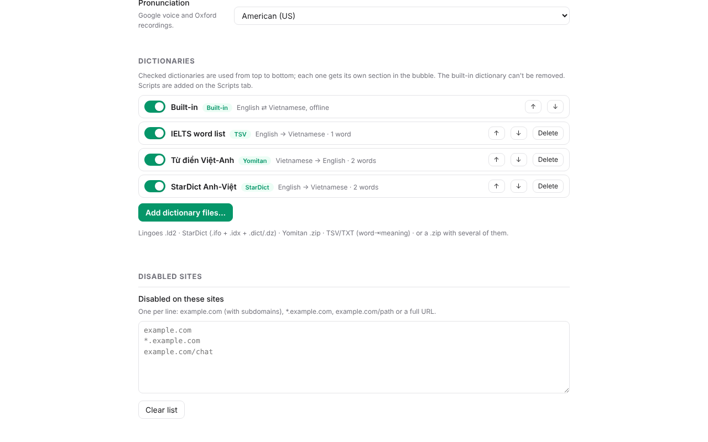

# Anki Quick Add (English ⇄ Vietnamese)

[Tiếng Việt](README.md) | **English**

A Chrome extension for learning English vocabulary while you read: **double-click a word** to see its Vietnamese meanings, pronunciation and word forms, then **save it as an Anki card** in one click. The dictionary works **offline** and needs no account.


## Contents

- [Features](#features)
- [Install](#install)
- [Set up Anki](#set-up-anki)
- [Usage](#usage)
- [The Anki card](#the-anki-card)
- [Studying with Anki — quick guide](#studying-with-anki--quick-guide)
- [Use your own note type](#use-your-own-note-type)
- [Dictionaries: built-in and your own](#dictionaries-built-in-and-your-own)
- [Lookup scripts](#lookup-scripts)
- [Extension settings](#extension-settings)
- [Privacy](#privacy)
- [For developers](#for-developers)
- [Data sources and licences](#data-sources-and-licences)

## Features

- **English → Vietnamese**: meanings by part of speech, IPA, audio, example sentences, technical meanings.
- **Word family**: *necessary → necessity, necessarily…* with IPA, an example and audio for each form.
- **Phrases**: select 2–8 words (*not necessarily*, *take into account*) to look up the whole phrase.
- **Vietnamese → English**: double-click a Vietnamese word and pick the English word to learn.
- **Collocations** from [ozdic.com](https://ozdic.com): pick one and its example becomes the card's sentence.
- **Words missing from the offline dictionary**: looked up on Oxford Learner's Dictionaries and translated with Google Translate.
- **Save to Anki**: edit the front, the answer and the sentence (bold, italic, underline, highlight), then *Save to Anki*. Audio for the word, its forms and the sentence is stored with the card.
- **Several dictionaries at once**: add your own (Lingoes `.ld2`, StarDict, Yomitan, TSV, or a `.zip` with several) right on the options page; each one gets its own section in the bubble.
- **Your own lookup scripts** (JavaScript / TypeScript), run in a sandbox.
- **Card options**: switch parts of the card on or off, or use **your own note type** and choose what goes into each field. American or British voice.
- **Turn it off per site**, e.g. work tools or chat apps — one click from the toolbar icon.
- **Custom CSS** for the lookup bubble.
- Light/dark theme; the bubble is isolated from the page (see [SECURITY.md](SECURITY.md)).

## Install

### Option 1 — Download a release (easiest)

1. Download `anki-quick-add-<version>.zip` from the repository's **Releases** page and unzip it.
2. Open `chrome://extensions` in Chrome and turn on **Developer mode** (top right).
3. Click **Load unpacked** and choose the unzipped folder.
4. Pin the extension (puzzle icon 🧩 → pin *Anki Quick Add*).

> Once the extension is on the Chrome Web Store, just click *Add to Chrome*.

### Option 2 — Build from source

Requires [Node.js](https://nodejs.org) 20+, Python 3.9+ and `git`.

```bash
git clone <repository URL> anki-quick-add
cd anki-quick-add
npm install          # uses the public npmjs.org registry (see .npmrc)
npm run dict         # downloads and builds the offline dictionary into data/dict (a few minutes the first time)
npm run build        # builds the extension into dist/
```

Then do steps 2–4 of Option 1 with the **`dist/`** folder.

**Update:** `git pull` → `npm install` → `npm run build` → click ↻ on the extension in `chrome://extensions` → reload open tabs.

## Set up Anki

The extension saves cards to **Anki desktop** through the **AnkiConnect** add-on.

1. Install [Anki](https://apps.ankiweb.net) (Windows, macOS, Linux).
2. In Anki: **Tools → Add-ons → Get Add-ons…** → code **`2055492159`** (AnkiConnect) → **OK** → restart Anki.
3. **Keep Anki open** while you save cards (minimized is fine).
4. On the first save Anki asks whether to allow the extension → click **Yes**.

The extension creates the deck (default `English`) and the note type **`EN-VI Vocab`**.

> **Note:** while Anki's **Browse / Add / Edit / Cards** window is open, AnkiConnect won't let the extension update the card templates. Close those windows if the extension reports an error.

## Usage

| Action | Result |
|---|---|
| **Double-click** a word | Opens the lookup bubble |
| **Select 2–8 words** with the mouse | Looks up the phrase (offline dictionary, otherwise Google Translate) |
| **⌥ Option + A** (macOS) / **Alt + A** (Windows, Linux) — default | Looks up the selection, or the word under the mouse pointer |
| Or **a single key** Shift / Ctrl / Option (Alt) / Command — chosen in Options | Press that key on its own with the mouse over a word (ODH style) |
| **Esc** or click outside | Closes the bubble |

In the bubble:

- 🔊 plays the word; every word form has its own play button.
- **Collocations** — common word combinations (ozdic.com); click one to make a card for it.
- **+ Anki** — opens the card editor:
  - **Front**: the word or phrase on the front.
  - **Answer (Vietnamese)**: the short answer you'll type when reviewing (prefilled).
  - **Sentence**: the sentence from the page; select text and use **B / I / U / Highlight**.
  - **Save to Anki** — saves the card.
- **⊘** — turns the extension off on this site (adds it to the blocklist).


## The Anki card

Cards use the note type **`EN-VI Vocab`**:

- **Front:** word, IPA, part of speech, word audio (autoplay), **a box to type the answer**, the sentence (word highlighted) with the article link right under it, the other word forms with examples.
- **Back:** your typed answer compared with the correct one, the answer, the sentence with its audio, explanation (if any), all meanings, word forms (▶ for each), technical meanings.


> Anki only draws the type-in box while you **study**. *Browse → Preview* doesn't show it; the card shows a hint there instead.

| Field | Content |
|---|---|
| Word | The front (word or phrase) |
| IPA, POS, Audio | Pronunciation, part of speech, word audio |
| Answer | Vietnamese answer (typed on the front, shown on the back) |
| Sentence, SentenceSound | Example sentence and its audio |
| Forms | The other word forms (IPA, example, ▶) |
| Meanings, Technical | All meanings, technical meanings |
| Explanation, Level | English explanation and CEFR level (filled for words from Oxford; otherwise yours to fill) |
| Source | Article link (page title) |
| Media, Data | Hidden: audio file list (so *Check Media* keeps them) and the raw lookup data |

## Studying with Anki — quick guide

Anki uses **spaced repetition**: cards you know well come back less and less often, cards you forget come back soon.

1. **Study every day.** Open Anki → click your deck (e.g. `English`) → **Study Now**. 10–15 minutes a day beats cramming.
2. **Front:** listen, read the sentence, **type the Vietnamese meaning** and press **Enter**.
3. **Back:** Anki marks correct parts green and wrong parts red. Then grade yourself:
   - **Again** — forgot: the card comes back in this session.
   - **Hard** — remembered with real difficulty.
   - **Good** — remembered (the button you'll use most).
   - **Easy** — too easy: much longer interval next time.
4. **Daily limits:** ⚙ next to the deck → **Options** → *New cards/day* (10–20 is a good start), *Maximum reviews/day* (e.g. 200).
5. **On your phone:** create a free [AnkiWeb](https://ankiweb.net) account, click **Sync** in Anki, then install **AnkiDroid** (Android, free) or **AnkiMobile** (iOS). Save cards on the computer, review on the phone.
6. **Tips:** turn on **FSRS** (Options → *Advanced* → FSRS) for better scheduling; add tags (e.g. `ielts`, `work`) to filter cards later.

## Use your own note type

By default cards use the `EN-VI Vocab` note type above. Two ways to customise, both in **Options → Services**:

**1. Switch parts of `EN-VI Vocab` on or off** — untick what you don't need: IPA, part of speech, audio, the type-in answer, sentence, sentence audio, word forms, meanings, technical meanings, explanation, article link. Switched-off parts stay empty, so they don't show on the card.

> Don't edit the `EN-VI Vocab` templates in Anki: the extension overwrites its templates and CSS whenever it updates the card design. For a different design, use option 2.

**2. Use your own note type**

1. In Anki: **Tools → Manage Note Types → Add** → **Add: Basic (type in the answer)** (or *Clone: EN-VI Vocab*) → name it, e.g. `My vocabulary`.
2. **Fields…** — the fields you want, e.g. `Word`, `Meaning`, `Example`, `Audio`.
3. **Cards…** — the templates, e.g.:
   - *Front Template*: `{{Word}} {{Audio}} {{type:Meaning}}`
   - *Back Template*: `{{FrontSide}}<hr id=answer>{{Meaning}}<br>{{Example}}`
   - *Styling*: the card's CSS.
4. In **Options → Services → Note type**, choose it. Each field is listed below; choose its data (the extension guesses from the field names):

   | Data | Content |
   |---|---|
   | Word / phrase | The front (word or phrase) |
   | Answer | Vietnamese answer |
   | IPA, Part of speech | Pronunciation, part of speech |
   | Word audio / Sentence audio | `[sound:…]` (audio is stored in Anki) |
   | Sentence | Example sentence (HTML, word highlighted) |
   | Meanings (HTML) / Meanings (plain text) | Meanings of all dictionaries / plain-text meanings |
   | Word forms, Technical meanings | Word family, technical meanings |
   | Explanation, CEFR level | From Oxford (when available) |
   | Article link, Page address, Page title | Where you found the word |

5. To move existing cards: **Browse** → select them → **Notes → Change Note Type…**.

**Allow duplicates** (off by default): when off, a word already in your collection isn't added again.

## Dictionaries: built-in and your own

The extension comes with an offline dictionary (**Built-in**):

| Direction | Dictionary | Notes |
|---|---|---|
| English → Vietnamese | [skypediacode/english-vietnamese-dictionary](https://github.com/skypediacode/english-vietnamese-dictionary) | ~105,000 entries, IPA and an example for every meaning; CC BY-SA 4.0 |
| Vietnamese → English | OVDP, Hồ Ngọc Đức, VNEDICT (via [thu-tram/viet-yomitan](https://github.com/thu-tram/viet-yomitan)) | ~60,000 entries |
| Word forms | WordNet 3.1 (npm package `wordnet-db`) | noun / verb / adjective / adverb families |

### Adding dictionaries (options page)



1. Click the extension icon → **All options…** → **Extension** tab → **Dictionaries**.
2. Click **Add dictionary files…** and pick one or more files — or a **`.zip`** with several dictionaries (nested zips work too).
3. For each dictionary found, check the **name** and **direction** (English → Vietnamese or Vietnamese → English; guessed for you) → **Import**. Big files (200,000+ entries) take about 20–30 seconds.
4. In the list: switch dictionaries on/off, reorder with ↑ ↓ (the top one is the main result: IPA, suggested answer), **Delete** to remove. Built-in can't be deleted but can be switched off.

Dictionaries are stored in the browser (IndexedDB) on this computer; nothing is uploaded.

**Supported formats:**

| Format | Files |
|---|---|
| Lingoes | `.ld2` — text style (`@word /ipa/`, `*part of speech`, `-meaning`), HTML style, and Prodict-style technical dictionaries (become the *Technical* section) — detected automatically |
| StarDict | `.ifo` + `.idx` (or `.idx.gz`) + `.dict` (or `.dict.dz`) — pick all three, or zip them together |
| Yomitan / Yomichan | `.zip` with `index.json` + `term_bank_*.json` |
| TSV / TXT | One line per word: `word<TAB>meaning 1; meaning 2<TAB>/ipa/<TAB>part of speech` (last two optional). Vietnamese → English: `vietnamese<TAB>english, english` |

### Suggested dictionaries

- **Lingoes English-Vietnamese**, **Free English-Vietnamese** and **Prodict (technical / IT)** — `.ld2` files from the [Lingoes](http://www.lingoes.net) dictionary library. They add ~30,000 words and phrases plus 200,000+ technical terms.
- **Apple, Babylon, SPDict Vietnamese → English**, **Lạc Việt** — Yomitan `.zip` files in [thu-tram/viet-yomitan](https://github.com/thu-tram/viet-yomitan) (download `dictionaries/<name>.zip`, then Import).
- **StarDict** English–Vietnamese / Vietnamese–English dictionaries of the *Free Vietnamese Dictionary Project* (Hồ Ngọc Đức) or OVDP.
- **Your own word list** — a TSV file (IELTS vocabulary, work terms…); move it to the top so your meanings come first.

> ⚖️ Lingoes, Prodict, Apple, Babylon and Lạc Việt are **not** open dictionaries: personal use only — do **not** commit or redistribute their data.

### Building from source

The Built-in dictionary is made by `npm run dict` from **`dictionaries.json`** (open sources only). To bake your own dictionaries into Built-in (instead of importing them on every computer): copy the files into `dictionaries/`, list them in **`dictionaries.local.json`** (ignored by git) and run `npm run dict` → `npm run build:data`:

```json
{
  "en-vi": [
    { "name": "Lingoes English-Vietnamese", "type": "lingoes", "file": "dictionaries/ev.ld2" },
    { "name": "Free English-Vietnamese", "type": "lingoes-html", "file": "dictionaries/free.ld2" },
    { "name": "Prodict technical", "type": "lingoes-technical", "file": "dictionaries/prodict.ld2" }
  ],
  "vi-en": [
    { "name": "Babylon Vietnamese-English (licence unclear — personal use)", "enabled": true }
  ]
}
```

`type`: `lingoes`, `lingoes-html`, `lingoes-technical`, `tsv`, `yomitan` (`"style"`: `definitions`, `words`, `babylon`, `spdict`). Your sources go after the built-in ones (they fill gaps); `"first": true` puts one first. `npm run package` always uses the open sources and never packages `dictionaries.local.json`.

## Lookup scripts

A script is a dictionary you write yourself (JavaScript or TypeScript) — e.g. meanings from a website or an API. **Options → Scripts → User scripts**:

1. **New script** (blank template) or **Add example (Free Dictionary)** (a TypeScript example using api.dictionaryapi.dev).
2. Write a `lookup(word, api)` function:

   ```ts
   // @name My dictionary
   // @host https://example.com
   async function lookup(word: string, api) {
     const doc = api.html(await api.fetch(`https://example.com/search?q=${encodeURIComponent(word)}`));
     const meanings = [...doc.querySelectorAll('.meaning')].map((e) => e.textContent.trim());
     return meanings.length ? { ipa: '', groups: [{ pos: 'noun', meanings, examples: [] }] } : null;
   }
   ```

   - `// @name` — the name shown in the bubble; `// @host` — sites the script may load (one per line, several allowed).
   - `api.fetch(url)` → text, `api.json(url)` → JSON, `api.html(text)` → a Document for `querySelector`.
   - Return `{ ipa?, groups: [{ pos?, meanings: [...], examples?: [...] }] }` or `null`.
3. **Save** — Chrome asks you to allow the `@host` sites. **Test** tries it with a word.
4. Switch scripts on/off and order them in the dictionary list (**Extension** tab). Script results get their own section in the bubble and are saved with the card.

Safety: scripts run in a separate **sandboxed** page — no access to the extension, the page you're reading or cookies; they can only load the `@host` sites you allowed; results are plain text.

**System scripts** (same tab): switch the built-in online helpers on/off — Oxford (words missing offline), Google Translate (phrases), Collocations (ozdic). Turn them all off to stay fully offline.

## Extension settings

**Click the extension icon** in the toolbar (quick settings):

| Setting | Meaning |
|---|---|
| *site name* + **Block this site** / **Unblock** | One click to turn the extension off (or back on) for the current site |
| Enabled | Turn the whole extension on/off |
| Mouse (double-click, select) | When off, only the hotkey works |
| Deck, Tags | Anki deck and tags for new cards |
| **All options…** | Opens the full options page |

**The options page** (from the popup, or `chrome://extensions` → Anki Quick Add → Details → Extension options) has four tabs:

| Tab | Content |
|---|---|
| **Extension** | Enabled, Mouse selection, **Hotkey** (⌥A/Alt+A, or a single Shift/Ctrl/Option/Command key pressed alone; Off), **Pronunciation** (US / UK), **Dictionaries** (list, order, Import), **Disabled sites** |
| **Services** | AnkiConnect status and version, **Deck**, **Note type** (EN-VI Vocab with parts on/off, or your own note type + field mapping), **Tags**, **Allow duplicates** |
| **Scripts** | System scripts (Oxford, Google Translate, Collocations), **User scripts** (write / edit / test), **Custom CSS** for the bubble |
| **Logs** | Detailed logging and the log viewer for troubleshooting |

**Disabled sites** (Extension tab), one pattern per line:

- `example.com` — the site and all its subdomains (`www.example.com`, `chat.example.com`)
- `*.example.com` — subdomains only
- `example.com/chat` — only URLs under that path
- `https://example.com/page` — full URLs work too
- `192.168.1.10:8080` — hosts with a port

Sites are also added when you click **⊘** in the bubble or **Block this site** in the popup.

**Custom CSS** (Scripts tab): applied to the lookup bubble after the built-in styles, e.g. `.bubble { width: 460px; font-size: 15px; }`. Main classes: `.bubble .header .body .footer .word .ipa .label .section .example .dict .btn .chip`.

## Privacy

The extension has no server of its own and collects nothing. What is sent where:

| To | When | What |
|---|---|---|
| Anki on your computer (`127.0.0.1:8765`) | Saving a card, listing decks | Card content, audio |
| translate.google.com | Playing or saving audio | The word / sentence to read |
| translate.googleapis.com | Words or phrases missing offline | The text to translate |
| oxfordlearnersdictionaries.com | Words missing offline | The word |
| ozdic.com | Clicking *Collocations* | The word |
| The `@host` sites of scripts you write | When looking up a word (if the script is on) | Whatever your script sends (usually the word) |

Imported dictionaries, scripts and CSS are stored only in the browser on this computer. No cookies are sent. The address of the page you read is only stored in the Anki card on your computer; only when you click 🔊 in the bubble may the browser include the page's origin (Referer) in the request to Google. Details: [PRIVACY.md](PRIVACY.md).

## For developers

| Command | What it does |
|---|---|
| `npm run dict` | Build the offline dictionary → `data/dict` (Python 3) |
| `npm run build` | Bundle TypeScript → `dist/` (esbuild); copies the data if `dist/dict` is missing |
| `npm run build:data` | Same, always re-copies the dictionary data |
| `npm run watch` | Rebuild on save |
| `npm run check` | Strict typecheck + lint (security rules) + unit tests |
| `npm run security` | `npm audit` + lint |
| `npm run package` | Build `release/anki-quick-add-<version>.zip` for the Chrome Web Store / GitHub Releases |

```
src/
  shared/      types, defaults (defaults.ts), HTML escaping/sanitizing, message validation, Anki note type
  background/  service worker: dictionary lookups, AnkiConnect, card builder, ozdic, Oxford, Google
  content/     content script: click context, bubble (closed shadow DOM), sentence editor
  pages/       popup and options page (options/: the tabs)
  sandbox/     sandboxed page that runs user scripts
  offscreen/   offscreen document hosting the sandbox, relays messages to the service worker
  shared/formats/  dictionary readers: ZIP, Lingoes .ld2, StarDict, Yomitan, TSV
scripts/       build.mjs, package.mjs, make_icons.py, dict/build_dict.py
static/        manifest.json, HTML pages, icons
store/         Chrome Web Store texts and images (see PUBLISHING.md)
```

- Fresh-install defaults (deck, tags, disabled sites): `src/shared/defaults.ts`.
- Card design: `src/shared/note-model.ts`; **bump `MODEL_VERSION`** and the extension updates the note type in Anki on the next save.
- Versions: git tags `vX.Y.Z` on `main`, listed in [CHANGELOG.md](CHANGELOG.md). Branch `local` is a backup of 1.0.0.
- Security: [SECURITY.md](SECURITY.md). Publishing: [PUBLISHING.md](PUBLISHING.md).

## Data sources and licences

- Code: [MIT](LICENSE).
- English → Vietnamese: skypediacode/english-vietnamese-dictionary (CC BY-SA 4.0; from minhqnd/dictionary, Wiktionary, vntk, Hồ Ngọc Đức, WikDict).
- Vietnamese → English: thu-tram/viet-yomitan (OVDP, Hồ Ngọc Đức, VNEDICT…).
- Word families: Princeton WordNet 3.1 (WordNet licence).
- Online (nothing stored in the extension): Oxford Learner's Dictionaries, Google Translate, ozdic.com.

Not affiliated with Anki, AnkiWeb, Oxford University Press, Google or ozdic.
