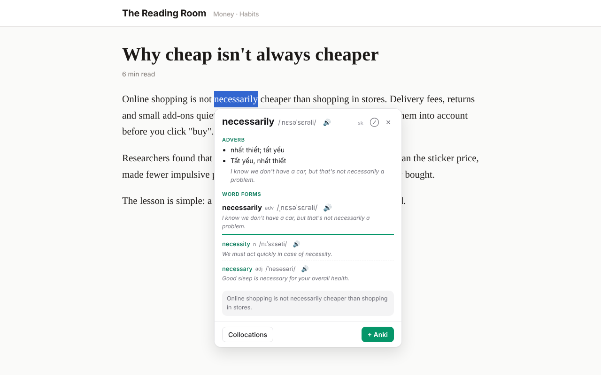
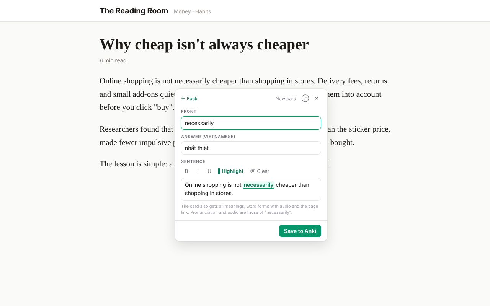
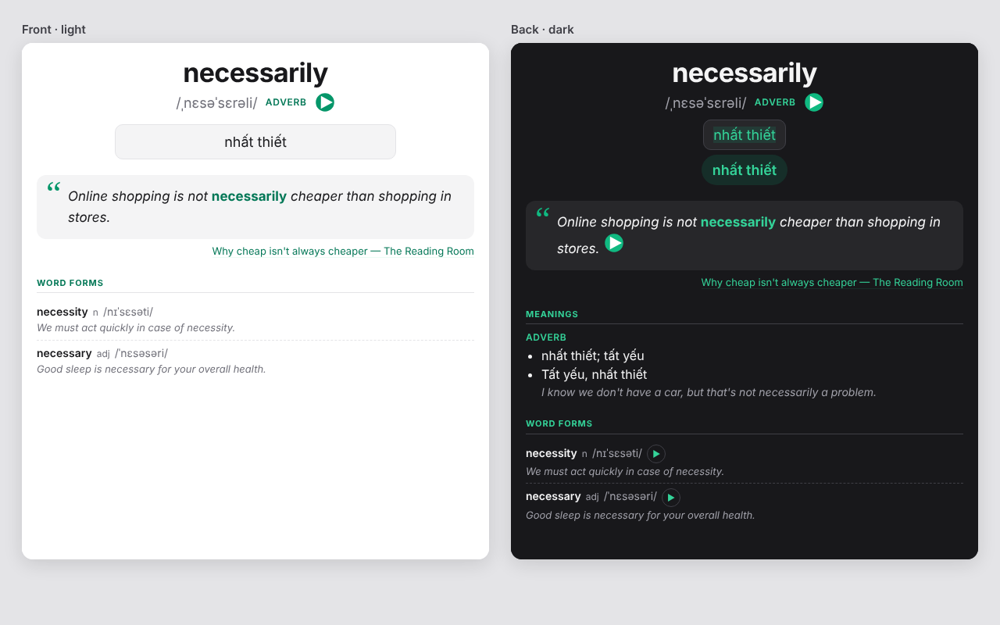

# Anki Quick Add (English ⇄ Vietnamese)

[Tiếng Việt](README.md) | **English**

A Chrome extension for learning English vocabulary while you read: **double-click a word** to see its Vietnamese meanings, pronunciation and word forms, then **save it as an Anki card** in one click. The dictionary works **offline** and needs no account.



## Contents

- [Features](#features)
- [Install](#install)
- [Set up Anki](#set-up-anki)
- [Usage](#usage)
- [The Anki card](#the-anki-card)
- [Studying with Anki — quick guide](#studying-with-anki--quick-guide)
- [Create your own vocabulary note type](#create-your-own-vocabulary-note-type)
- [Dictionaries: built-in and your own](#dictionaries-built-in-and-your-own)
- [Extension settings](#extension-settings)
- [Privacy](#privacy)
- [For developers](#for-developers)
- [Data sources and licences](#data-sources-and-licences)

## Features

- **English → Vietnamese**: meanings by part of speech, IPA, audio, example sentences, technical meanings.
- **Word family**: *necessary → necessity, necessarily…* with IPA, an example and audio for each form.
- **Phrases**: select 2–8 words (*not necessarily*, *take into account*) to look up the whole phrase.
- **Vietnamese → English**: double-click a Vietnamese word and pick the English word to learn.
- **Collocations** from [ozdic.com](https://ozdic.com): pick one and its example becomes the card's sentence.
- **Words missing from the offline dictionary**: looked up on Oxford Learner's Dictionaries and translated with Google Translate.
- **Save to Anki**: edit the front, the answer and the sentence (bold, italic, underline, highlight), then *Save to Anki*. Audio for the word, its forms and the sentence is stored with the card.
- **Turn it off per site**, e.g. work tools or chat apps.
- Light/dark theme; the bubble is isolated from the page (see [SECURITY.md](SECURITY.md)).

## Install

### Option 1 — Download a release (easiest)

1. Download `anki-quick-add-<version>.zip` from the repository's **Releases** page and unzip it.
2. Open `chrome://extensions` in Chrome and turn on **Developer mode** (top right).
3. Click **Load unpacked** and choose the unzipped folder.
4. Pin the extension (puzzle icon 🧩 → pin *Anki Quick Add*).

> Once the extension is on the Chrome Web Store, just click *Add to Chrome*.

### Option 2 — Build from source

Requires [Node.js](https://nodejs.org) 20+, Python 3.9+ and `git`.

```bash
git clone <repository URL> anki-quick-add
cd anki-quick-add
npm install          # uses the public npmjs.org registry (see .npmrc)
npm run dict         # downloads and builds the offline dictionary into data/dict (a few minutes the first time)
npm run build        # builds the extension into dist/
```

Then do steps 2–4 of Option 1 with the **`dist/`** folder.

**Update:** `git pull` → `npm install` → `npm run build` → click ↻ on the extension in `chrome://extensions` → reload open tabs.

## Set up Anki

The extension saves cards to **Anki desktop** through the **AnkiConnect** add-on.

1. Install [Anki](https://apps.ankiweb.net) (Windows, macOS, Linux).
2. In Anki: **Tools → Add-ons → Get Add-ons…** → code **`2055492159`** (AnkiConnect) → **OK** → restart Anki.
3. **Keep Anki open** while you save cards (minimized is fine).
4. On the first save Anki asks whether to allow the extension → click **Yes**.

The extension creates the deck (default `English`) and the note type **`EN-VI Vocab`**.

> **Note:** while Anki's **Browse / Add / Edit / Cards** window is open, AnkiConnect won't let the extension update the card templates. Close those windows if the extension reports an error.

## Usage

| Action | Result |
|---|---|
| **Double-click** a word | Opens the lookup bubble |
| **Select 2–8 words** with the mouse | Looks up the phrase (offline dictionary, otherwise Google Translate) |
| **⌥ Option + A** (macOS) / **Alt + A** (Windows, Linux) | Looks up the selection, or the word under the mouse pointer |
| **Esc** or click outside | Closes the bubble |

In the bubble:

- 🔊 plays the word; every word form has its own play button.
- **Collocations** — common word combinations (ozdic.com); click one to make a card for it.
- **+ Anki** — opens the card editor:
  - **Front**: the word or phrase on the front.
  - **Answer (Vietnamese)**: the short answer you'll type when reviewing (prefilled).
  - **Sentence**: the sentence from the page; select text and use **B / I / U / Highlight**.
  - **Save to Anki** — saves the card.
- **⊘** — turns the extension off on this site (adds it to the blocklist).



## The Anki card

Cards use the note type **`EN-VI Vocab`**:

- **Front:** word, IPA, part of speech, word audio (autoplay), **a box to type the answer**, the sentence (word highlighted) with the article link right under it, the other word forms with examples.
- **Back:** your typed answer compared with the correct one, the answer, the sentence with its audio, explanation (if any), all meanings, word forms (▶ for each), technical meanings.



> Anki only draws the type-in box while you **study**. *Browse → Preview* doesn't show it; the card shows a hint there instead.

| Field | Content |
|---|---|
| Word | The front (word or phrase) |
| IPA, POS, Audio | Pronunciation, part of speech, word audio |
| Answer | Vietnamese answer (typed on the front, shown on the back) |
| Sentence, SentenceSound | Example sentence and its audio |
| Forms | The other word forms (IPA, example, ▶) |
| Meanings, Technical | All meanings, technical meanings |
| Explanation, Level | English explanation and CEFR level (filled for words from Oxford; otherwise yours to fill) |
| Source | Article link (page title) |
| Media, Data | Hidden: audio file list (so *Check Media* keeps them) and the raw lookup data |

## Studying with Anki — quick guide

Anki uses **spaced repetition**: cards you know well come back less and less often, cards you forget come back soon.

1. **Study every day.** Open Anki → click your deck (e.g. `English`) → **Study Now**. 10–15 minutes a day beats cramming.
2. **Front:** listen, read the sentence, **type the Vietnamese meaning** and press **Enter**.
3. **Back:** Anki marks correct parts green and wrong parts red. Then grade yourself:
   - **Again** — forgot: the card comes back in this session.
   - **Hard** — remembered with real difficulty.
   - **Good** — remembered (the button you'll use most).
   - **Easy** — too easy: much longer interval next time.
4. **Daily limits:** ⚙ next to the deck → **Options** → *New cards/day* (10–20 is a good start), *Maximum reviews/day* (e.g. 200).
5. **On your phone:** create a free [AnkiWeb](https://ankiweb.net) account, click **Sync** in Anki, then install **AnkiDroid** (Android, free) or **AnkiMobile** (iOS). Save cards on the computer, review on the phone.
6. **Tips:** turn on **FSRS** (Options → *Advanced* → FSRS) for better scheduling; add tags (e.g. `ielts`, `work`) to filter cards later.

## Create your own vocabulary note type

The extension always saves to `EN-VI Vocab` and **overwrites its templates and CSS whenever it updates the card design**. For your own design, create a new note type instead of editing `EN-VI Vocab`:

1. **Tools → Manage Note Types → Add**.
2. Choose **Clone: EN-VI Vocab** (same fields) or **Add: Basic (type in the answer)** (a simple type-in card) → name it, e.g. `My vocabulary`.
3. **Fields…** to add or rename fields, e.g. `Word`, `Meaning`, `Example`, `Audio`.
4. **Cards…** to edit the templates:
   - *Front Template*, e.g. `{{Word}} {{Audio}} {{type:Meaning}}`
   - *Back Template*, e.g. `{{FrontSide}}<hr id=answer>{{Meaning}}<br>{{Example}}`
   - *Styling*: the card's CSS.
5. To move existing cards: **Browse** → select them → **Notes → Change Note Type…**.

> A later version will let you choose the note type and map fields (like ODH).

## Dictionaries: built-in and your own

`npm run dict` builds the offline dictionary from the sources in **`dictionaries.json`**. The defaults are **open** dictionaries (redistributable):

| Direction | Dictionary | Notes |
|---|---|---|
| English → Vietnamese | [skypediacode/english-vietnamese-dictionary](https://github.com/skypediacode/english-vietnamese-dictionary) | ~105,000 entries, IPA and an example for every meaning; CC BY-SA 4.0 |
| Vietnamese → English | OVDP, Hồ Ngọc Đức, VNEDICT (via [thu-tram/viet-yomitan](https://github.com/thu-tram/viet-yomitan)) | ~60,000 entries |
| Word forms | WordNet 3.1 (npm package `wordnet-db`) | noun / verb / adjective / adverb families |

### Adding dictionaries

1. Copy the dictionary files into **`dictionaries/`** (ignored by git).
2. Create **`dictionaries.local.json`** (ignored by git), for example:

   ```json
   {
     "en-vi": [
       { "name": "Lingoes English-Vietnamese", "type": "lingoes", "file": "dictionaries/ev.ld2" },
       { "name": "Free English-Vietnamese", "type": "lingoes-html", "file": "dictionaries/free.ld2" },
       { "name": "Prodict technical", "type": "lingoes-technical", "file": "dictionaries/prodict.ld2" },
       { "name": "My words", "type": "tsv", "file": "dictionaries/my-words.tsv", "first": true }
     ],
     "vi-en": [
       { "name": "Babylon Vietnamese-English (licence unclear — personal use)", "enabled": true }
     ]
   }
   ```

3. Run `npm run dict`, then `npm run build:data`, and click ↻ on the extension.

**Priority:** earlier sources win. Your sources go **after** the built-in ones (they only fill gaps); add `"first": true` to put one **before** them. To turn on a built-in source that is off, repeat its exact `name` with `"enabled": true`.

**Supported formats:**

| `type` | For |
|---|---|
| `lingoes` | Lingoes `.ld2` with text entries (`@word /ipa/`, `*part of speech`, `-meaning`), e.g. *Lingoes English-Vietnamese* |
| `lingoes-html` | Lingoes `.ld2` with HTML entries, e.g. *Free English-Vietnamese Dictionary* |
| `lingoes-technical` | Prodict-style technical dictionary: adds a *Technical* section |
| `tsv` | Text file, one line per word: `word<TAB>meaning 1; meaning 2<TAB>/ipa/<TAB>part of speech` (last two optional). For `vi-en`: `vietnamese<TAB>english, english` |
| `yomitan` | Yomitan/Yomichan `.zip` (Vietnamese → English); `"style"`: `definitions`, `words`, `babylon`, `spdict` |

### Suggested dictionaries

- **Lingoes English-Vietnamese**, **Free English-Vietnamese** and **Prodict (technical / IT)** — `.ld2` files from the [Lingoes](http://www.lingoes.net) dictionary library. They add ~30,000 words and phrases plus 200,000+ technical terms.
- **Apple, Babylon, SPDict Vietnamese → English** — already listed in `dictionaries.json` but off; turn them on with `"enabled": true` (~126,000 Vietnamese headwords, plus technical terms).
- **Lạc Việt** (Yomitan format) — link in the [viet-yomitan README](https://github.com/thu-tram/viet-yomitan).
- **Your own word list** — a `tsv` file (IELTS vocabulary, work terms…); use `"first": true` so your meanings win.

> ⚖️ Lingoes, Prodict, Apple, Babylon and Lạc Việt are **not** open dictionaries: personal use only — do **not** commit or redistribute their data. `npm run package` refuses to package a dictionary built with private sources.

## Extension settings

**Click the extension icon** in the toolbar:

| Setting | Meaning |
|---|---|
| Enabled | Turn the whole extension on/off |
| On *this site* | Turn it on/off for the current site |
| Mouse (double-click) | When off, only the ⌥A / Alt+A hotkey works |
| Deck | Anki deck for new cards (list from Anki) |
| Tags | Tags added to every card, comma-separated |

**`chrome://extensions` → Anki Quick Add → Details → Extension options** adds:

- **Disabled sites**, one pattern per line:
  - `example.com` — the site and all its subdomains (`www.example.com`, `chat.example.com`)
  - `*.example.com` — subdomains only
  - `example.com/chat` — only URLs under that path
  - `https://example.com/page` — full URLs work too
  - `192.168.1.10:8080` — hosts with a port
- **Record detailed logs** and **Logs** — for troubleshooting.

Sites are added to the list when you click **⊘** in the bubble or switch off *On this site* in the popup.

## Privacy

The extension has no server of its own and collects nothing. What is sent where:

| To | When | What |
|---|---|---|
| Anki on your computer (`127.0.0.1:8765`) | Saving a card, listing decks | Card content, audio |
| translate.google.com | Playing or saving audio | The word / sentence to read |
| translate.googleapis.com | Words or phrases missing offline | The text to translate |
| oxfordlearnersdictionaries.com | Words missing offline | The word |
| ozdic.com | Clicking *Collocations* | The word |

No cookies are sent. The address of the page you read is only stored in the Anki card on your computer; only when you click 🔊 in the bubble may the browser include the page's origin (Referer) in the request to Google. Details: [PRIVACY.md](PRIVACY.md).

## For developers

| Command | What it does |
|---|---|
| `npm run dict` | Build the offline dictionary → `data/dict` (Python 3) |
| `npm run build` | Bundle TypeScript → `dist/` (esbuild); copies the data if `dist/dict` is missing |
| `npm run build:data` | Same, always re-copies the dictionary data |
| `npm run watch` | Rebuild on save |
| `npm run check` | Strict typecheck + lint (security rules) + unit tests |
| `npm run security` | `npm audit` + lint |
| `npm run package` | Build `release/anki-quick-add-<version>.zip` for the Chrome Web Store / GitHub Releases |

```
src/
  shared/      types, defaults (defaults.ts), HTML escaping/sanitizing, message validation, Anki note type
  background/  service worker: dictionary lookups, AnkiConnect, card builder, ozdic, Oxford, Google
  content/     content script: click context, bubble (closed shadow DOM), sentence editor
  pages/       popup and options page
scripts/       build.mjs, package.mjs, make_icons.py, dict/build_dict.py
static/        manifest.json, HTML pages, icons
store/         Chrome Web Store texts and images (see PUBLISHING.md)
```

- Fresh-install defaults (deck, tags, disabled sites): `src/shared/defaults.ts`.
- Card design: `src/shared/note-model.ts`; **bump `MODEL_VERSION`** and the extension updates the note type in Anki on the next save.
- Versions: git tags `vX.Y.Z` on `main`, listed in [CHANGELOG.md](CHANGELOG.md). Branch `local` is a backup of 1.0.0.
- Security: [SECURITY.md](SECURITY.md). Publishing: [PUBLISHING.md](PUBLISHING.md).

## Data sources and licences

- Code: [MIT](LICENSE).
- English → Vietnamese: skypediacode/english-vietnamese-dictionary (CC BY-SA 4.0; from minhqnd/dictionary, Wiktionary, vntk, Hồ Ngọc Đức, WikDict).
- Vietnamese → English: thu-tram/viet-yomitan (OVDP, Hồ Ngọc Đức, VNEDICT…).
- Word families: Princeton WordNet 3.1 (WordNet licence).
- Online (nothing stored in the extension): Oxford Learner's Dictionaries, Google Translate, ozdic.com.

Not affiliated with Anki, AnkiWeb, Oxford University Press, Google or ozdic.
